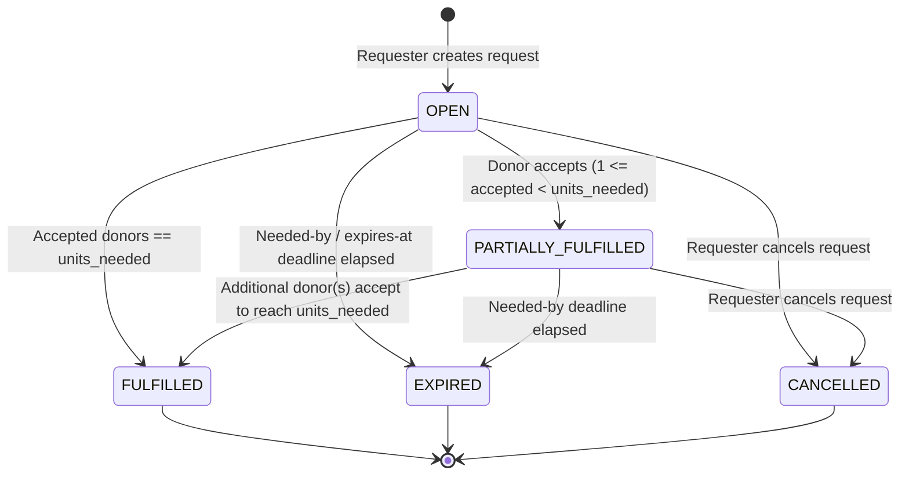
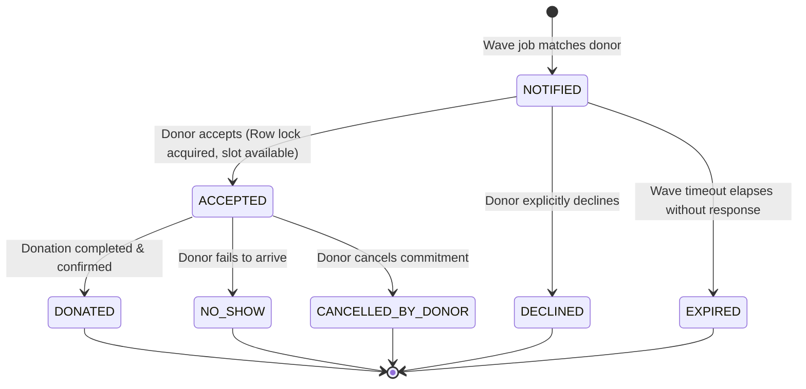

# RoktoBondhu (রক্তবন্ধু) — Real-Time Blood Donation Matcher

> **Disclaimer:** This is an engineering portfolio/learning project, not a certified medical device or clinical product. Eligibility rules, wait periods, and compatibility matrices are configurable defaults and must strictly follow local public health guidelines.

A transactional web platform and distributed backend connecting patients who urgently need blood with nearby, compatible, and eligible donors in expanding geographic proximity waves.

---

## 1. Problem Statement

In developing regions, emergency blood requests often circulate as chaotic, unverified social media posts and frantic phone chains:
- **No Compatibility Verification:** Incompatible or ineligible donors frequently travel to hospitals only to be turned away.
- **Alert Fatigue & Over-saturation:** Blasting thousands of donors simultaneously creates spam; or worse, multiple donors arrive simultaneously when only 1 or 2 units are required.
- **Privacy Leaks:** Requester and patient personal phone numbers are publicly broadcast, leading to harassment and scams.

**RoktoBondhu** solves this by:
1. Matching recipients only with **verified, compatible, and eligible donors** using PostGIS spatial indexing.
2. Dispatching alerts in **automated expanding rings (waves)**, notifying the closest donors first.
3. Enforcing **strict database row-level locking (`SELECT ... FOR UPDATE`)** to guarantee that exactly `N` units needed are accepted without race conditions.
4. Keeping contact information private until a donor commits to donate.

---

## 2. Architecture Overview

```text
                                +-------------------+
                                |   Web Browser     |
                                |  (React 18 + Vite)|
                                +---------+---------+
                                          |
                                          v
                                +-------------------+
                                |   Nginx Gateway   |
                                |  Reverse Proxy :80|
                                +----+---------+----+
                                     |         |
                      /api, /auth    |         |  / (Static SPA)
                                     v         v
                         +---------------+  +---------------+
                         |   Core API    |  | Frontend Nginx|
                         |  Node.js :5000|  | Web Container |
                         +---+-------+---+  +---------------+
                             |       |
            Transactional DB |       | Asynchronous Events
                             v       v
         +---------------------+   +---------------------+
         | PostgreSQL + PostGIS|   |   Redis + BullMQ    |
         | (Spatial Indexing)  |   | (Queue / Job Bus)   |
         +---------------------+   +----------+----------+
                                              |
                                              v
                                   +---------------------+
                                   | Notification Engine |
                                   | (Worker Daemon)     |
                                   +----+-----------+----+
                                        |           |
                           In-App Alerts|           | Email Dispatch
                                        v           v
                                    Postgres    Mailpit (SMTP)
```

### Services
- **`gateway`**: Nginx proxy routing traffic to frontend static assets and backend API endpoints.
- **`frontend`**: React 18 SPA built with Vite, Tailwind CSS, TanStack Query, and React Router.
- **`core-api`**: Express REST API handling auth (JWT + OTP), donor profiles, PostGIS spatial queries, request matching state machine, and atomic row locking.
- **`notification-service`**: Autonomous BullMQ background worker consuming notification jobs and delivering via In-App database logs, SMTP (Mailpit), and mock SMS.
- **`postgres`**: PostgreSQL 16 with PostGIS 3.4 spatial extensions and spatial GIST indexing on geographic coordinates (`GEOGRAPHY(Point, 4326)`).
- **`redis`**: In-memory Redis 7 message broker driving BullMQ queues for wave escalation and notification retries with exponential backoff.
- **`mailpit`**: Development SMTP server and webmail client (`:8025`) for visual inspection of transactional emails.

---

## 3. State Machine Diagrams

### 3.1 Blood Request Lifecycle


### 3.2 Donor Match Lifecycle


---

## 4. Key Design Decisions

### 4.1 Strict Row-Locking for Concurrency Control
- **The Problem:** In an emergency, multiple matched donors may tap "Accept" on their phones within the exact same second. If 2 units are required and 5 donors accept simultaneously, naive `UPDATE` queries produce race conditions resulting in 5 accepted donors.
- **The Solution:** Acceptance executes inside a dedicated PostgreSQL database transaction with `SELECT * FROM blood_requests WHERE id = $1 FOR UPDATE`. This row-level exclusive lock forces concurrent accept requests to serialize. The transaction verifies whether `units_fulfilled < units_needed`. If slots remain, the match transitions to `ACCEPTED` and `units_fulfilled` increments; if the quota is reached, subsequent transactions roll back immediately with HTTP `409 Conflict ("Blood request is already fulfilled")`.

### 4.2 Proximity Waves vs. Broadcast Blasts
- **The Problem:** Broadcasting an emergency notification to thousands of donors across an entire metropolitan area causes alert fatigue, unnecessary traffic, and frustration for distant donors.
- **The Solution:** Matching executes in expanding geographic rings (e.g. Ring 1: 0–5 km, Ring 2: 5–10 km, Ring 3: 10–25 km, Ring 4: 25–50 km). The closest eligible donors are notified in Wave 1. If units remain unfulfilled after the wave timeout (10 min for `CRITICAL`, 60 min for `NORMAL`), BullMQ automatically schedules and triggers the next wave to expand the radius outward.

### 4.3 Clean Microservice Decoupling
- **The Problem:** Third-party notification delivery (SMTP servers, SMS gateways, push services) can suffer latency spikes or outages. Executing notifications synchronously inside API request-response loops degrades user experience and blocks transactions.
- **The Solution:** The core domain (`core-api`) enqueues lightweight notification tasks to Redis BullMQ queues. The dedicated worker (`notification-service`) handles retries, rate limits, template rendering, and delivery independently without slowing down core transactions.

---

## 5. Quick Start (One-Command Run)

### Prerequisites
- [Docker](https://docs.docker.com/get-docker/) & [Docker Compose](https://docs.docker.com/compose/)
- [Node.js](https://nodejs.org/) >= 20 (for local development/testing)

### One-Command Setup & Launch
```bash
# 1. Clone repository
git clone https://github.com/ZamanAsad007/RoktoBondhu.git
cd RoktoBondhu

# 2. Start all services, databases, worker daemons, and proxy
make up
```

All services will start up:
| Component | URL | Notes |
|---|---|---|
| **Web Application** | `http://localhost:3000` (or `http://localhost`) | React Frontend UI |
| **API Gateway** | `http://localhost:5000/api` | Express REST API |
| **Mailpit Inbox** | `http://localhost:8025` | Inspect outgoing emails |
| **PostgreSQL / PostGIS** | `localhost:5433` | Database (`roktobondhu`) |
| **Redis** | `localhost:6380` | BullMQ message broker |

### Seed & Interactive Emergency Demo
```bash
# Seed 200 volunteer donors across Dhaka and execute live matching demo
make demo
```
This single command:
1. Applies all PostgreSQL database migrations.
2. Seeds 200 realistic volunteer donors across Dhaka neighborhoods.
3. Spawns an urgent emergency 2-unit request at Dhaka Medical College Hospital.
4. Triggers PostGIS wave matching and dispatches alerts directly to the Mailpit inbox.

---

## 6. Makefile Command Reference

```bash
make help        # Display all available commands
make up          # Start full Docker Compose stack in background
make down        # Stop and tear down all containers
make restart     # Restart stack containers
make build       # Rebuild all multi-stage Docker images
make logs        # Tail consolidated logs across all containers
make migrate     # Execute database migrations
make seed        # Seed donor profiles
make test        # Run unit, integration, and frontend test suites
make demo        # Run the live emergency matching wave demo
```

---

## 7. What I'd Improve (Post-v1.0 Roadmap)

- **Real-Time Streaming (SSE / WebSockets):** Replace client-side polling with Server-Sent Events or WebSockets for live match updates and donation status shifts.
- **Gamification & Donor Retention:** Automatic streak tracking, badge awards (Life Saver, Rapid Responder), and downloadable PDF donation certificates.
- **SOS Emergency Escalation:** Allow requesters to trigger emergency SOS broadcasts with wider radii and shorter wave timeouts.
- **Institutional Blood Bank Inventory:** Support hospitals and blood banks with live inventory tracking and community blood drive RSVP systems.
- **Outbox Pattern:** Implement the Transactional Outbox pattern with Debezium or PostgreSQL CDC for zero-loss distributed event delivery.
